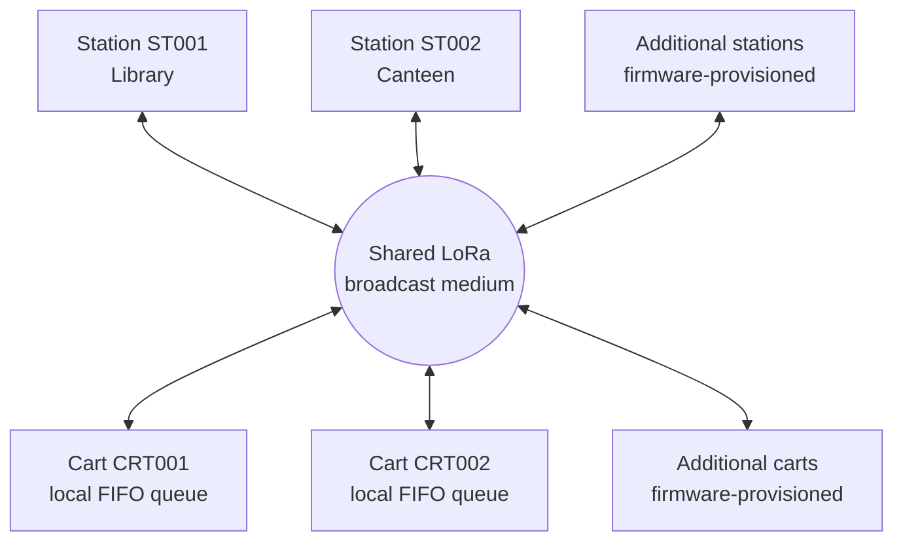

# System Architecture Diagram

## Notes

- Diagram is logical, not a coverage map.
- Every node uses compatible RF/modem settings and network/protocol configuration.
- Requests are broadcast; a claim/assignment exchange is required to prevent duplicate cart service.
- FIFO ordering is local to each cart queue, not one globally synchronized campus queue.
- The system does not use a cloud server or non-LoRa communication path.
