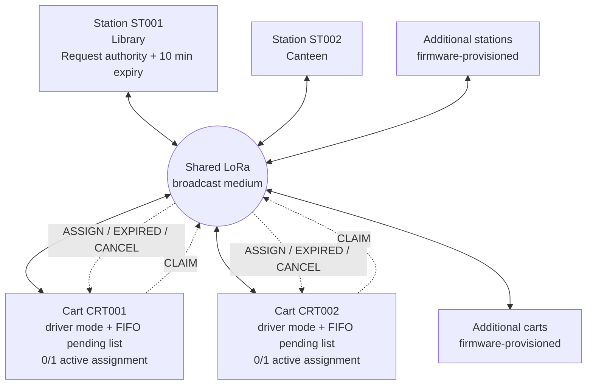

# System Architecture Diagram

## Operating rules

- All carts continuously listen, including when the driver is not accepting requests.
- Each cart maintains a local FIFO list of unaccepted/unassigned requests.
- Driver acceptance must be enabled before a cart can claim; each cart may hold at most one active assignment.
- The originating station commits one winning cart and announces the assignment. Other carts remove that request from pending when they receive the announcement.
- Disabling acceptance clears that cart's current local pending list only; it does not cancel the station-owned request.
- After journey completion, the driver must manually re-enable acceptance.
- Unaccepted requests expire after 10 minutes by default; the originating station is authoritative.
- FIFO ordering is local to each cart, not one globally synchronized campus queue.
- Diagram is logical, not a coverage map. No cloud server or non-LoRa communication path is used.
